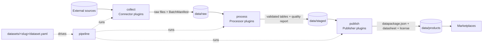

# Architecture

- **Stages** (`collect`, `process`, `publish`) are independent packages. They share only
  `contracts` (Pydantic models) and `core` (config, errors, storage paths), and hand data over via files in
  the data zones. A stage can be re-run alone from the previous zone.
- **Plugins**: each stage has an interface (`base.py`), an explicit `registry.py`, and one file per plugin.
  New source / transform / marketplace = new plugin file; existing ones stay untouched.
- **Datasets** are declarative (`dataset.yaml`) and versioned (semver + immutable `schema/vN.json`).
- **Lineage**: every product records the raw batch ids, connector/processor versions and checksums it was
  built from.
- Import direction, enforced by `import-linter` (`pyproject.toml`):
  `cli → ui → pipeline → collect | process | publish → contracts → core`.
- **UI** (`ui/`, ADR 0003): local FastAPI app started by `datafactory ui`; runs `pipeline.run` in a
  background thread per dataset and renders zone files read through `contracts` models.

Run: `uv run datafactory run <slug> [--stage collect|process|publish] [--batch ID] [--release]`.

- `collect/stage.py`: connector → raw batch; `batch_id` = hash(connector, params, file checksums), so
  re-collecting unchanged data reuses the batch.
- `process/stage.py`: processor steps → `process/validate.py` (schema check; bad rows → `quarantine.csv`)
  → `staged/<slug>/<batch_id>/` with quality report.
- `publish/package.py`: quality gates → immutable `products/<slug>/<version>/` (`data.csv`, `README.md`,
  `LICENSE`, `datapackage.json`); then publishers run (`remote` ones only with `--release`).
- Golden test (`tests/test_golden_datasets.py`) replays `datasets/<slug>/fixtures/input` (a recorded raw
  batch) through process + publish and compares with `fixtures/expected` byte for byte.
