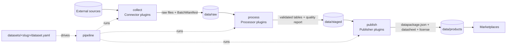

# Architecture

- **Stages** (`collect`, `process`, `publish`) are independent packages. They share only
  `contracts` (Pydantic models) and `core` (config, errors, storage paths), and hand data over via files in
  the data zones. A stage can be re-run alone from the previous zone.
- **Plugins**: each stage has an interface (`base.py`), an explicit `registry.py`, and one file per plugin.
  New source / transform / marketplace = new plugin file; existing ones stay untouched.
- **Datasets** are declarative (`dataset.yaml`) and versioned (semver + immutable `schema/vN.json`).
- **Lineage**: every product records the raw batch ids, connector/processor versions and checksums it was
  built from.
- Import direction, enforced by `import-linter` (`pyproject.toml`):
  `cli → pipeline → collect | process | publish → contracts → core`.

Status: skeleton only — interfaces and pipeline are specified in
`docs/features/project-skeleton.md`.
